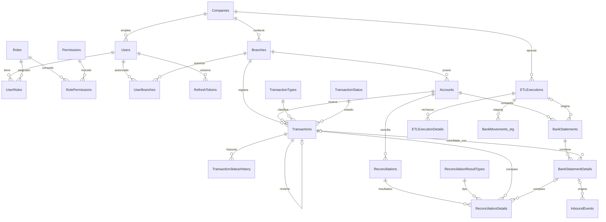
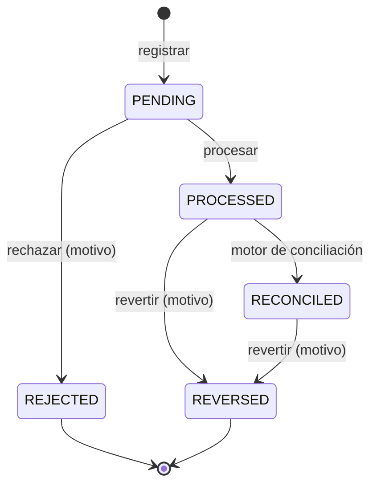

# Modelo de datos

Fuente de verdad: los scripts de [`database/`](../../database/README.md). Este documento los resume.

## Diagrama entidad-relación

## Tablas por módulo

| Esquema | Tabla | Responsabilidad | Restricciones clave |
|---|---|---|---|
| sec | Companies | Empresas (tenant) | NIT único |
| sec | Branches | Sucursales | Código único por empresa; clave alterna `(Id, CompanyId)` |
| sec | Users | Usuarios | Usuario y correo únicos; `RowVersion` |
| sec | Roles · Permissions · RolePermissions · UserRoles | Autorización por permisos | Ids fijos |
| sec | UserBranches | Sucursales autorizadas | FK compuestas: usuario y sucursal de la misma empresa |
| sec | RefreshTokens | Sesiones con rotación | Se guarda el SHA-256 |
| fin | Accounts | Cuentas financieras ↔ cuenta bancaria | Cuenta bancaria única por empresa; FK compuesta a la sucursal |
| fin | TransactionTypes · TransactionStatus | Catálogos (= enums del dominio) | Ids fijos |
| fin | Transactions | Operaciones | Referencia única por empresa; `SignedAmount` persistido; reversión única; CHECK de valor, rechazo, reversión, conciliación |
| fin | TransactionStatusHistory | Historial de estados | Solo inserción; lo llena un trigger |
| etl | ETLExecutions · ETLExecutionDetails | Historial de cargas y rechazos por fila | `RowsRead = RowsLoaded + RowsRejected` al terminar |
| stg | BankMovements | Movimientos crudos (texto) | PK `(EtlExecutionId, RowNumber)` |
| rec | BankStatements · BankStatementDetails | Extractos y movimientos | `(AccountId, ExternalMovementId)` único; valor ≠ 0 con signo |
| rec | Reconciliations · ReconciliationDetails · ReconciliationResultTypes | Ejecuciones y resultados | Una `RUNNING` por cuenta (índice filtrado) |
| integration | InboundEvents | Webhooks recibidos | `(Provider, ExternalEventId)` único; payload JSON |
| audit | AuditLogs | Auditoría | Solo inserción; valores JSON |

Comparado con la propuesta inicial se agregaron `Permissions`, `RolePermissions`, `UserRoles` y `RefreshTokens` (roles **y** permisos,
sesiones), `TransactionStatusHistory` (trazabilidad de estados), `stg.BankMovements` (staging del ETL), `ReconciliationResultTypes`
(catálogo de resultados) e `InboundEvents` (idempotencia de webhooks).

## Estados de una operación

| Regla | Dónde se aplica |
|---|---|
| Transiciones permitidas, doble control, quién puede editar | Dominio (.NET) |
| Solo el motor pasa a Conciliada | Dominio (no hay endpoint) + `rec.usp_RunReconciliation` |
| Datos financieros inmutables después de Pendiente (50010) | Dominio + trigger |
| Rechazada/Revertida finales; Conciliada solo a Revertida (50012) | Dominio + trigger |
| Sin borrado (50011) | No hay endpoint + trigger `INSTEAD OF DELETE` |
| Motivo de rechazo, reversión con original, valor positivo | Dominio + `CHECK` |

## Signo de los valores

`fin.Transactions.Amount` es siempre positivo y `Direction` vale 1 (entra) o −1 (sale); `SignedAmount = Amount × Direction`.
`rec.BankStatementDetails.Amount` ya viene con signo. La conciliación compara `SignedAmount` con `Amount` del banco.

| Tipo | Direction |
|---|---|
| ING Ingreso | +1 |
| EGR Egreso · TRF Transferencia · PAG Pago | −1 |
| REV Reversión | contrario a la original |

## Índices

Cada índice documenta en su script la consulta que atiende. Los más relevantes:

| Índice | Consulta |
|---|---|
| `IX_Transactions_Branch_OperationDate` (INCLUDE estado, tipo, valor) | Listado por sucursal y período; resumen por sucursal |
| `IX_Transactions_Account_Status_OperationDate` | Insumos del motor de conciliación |
| `IX_BankStatementDetails_Account_Match_Date` | Movimientos sin conciliar del período |
| `IX_BankStatementDetails_Account_Reference` (filtrado) | Detección de referencias duplicadas |
| `UX_Transactions_Company_IdempotencyKey` (único filtrado) | Idempotencia de la API |
| `UX_Reconciliations_Account_Running` (único filtrado) | Una conciliación en curso por cuenta |
| `IX_AuditLogs_CorrelationId` (filtrado) | Soporte: todo lo de una petición |
